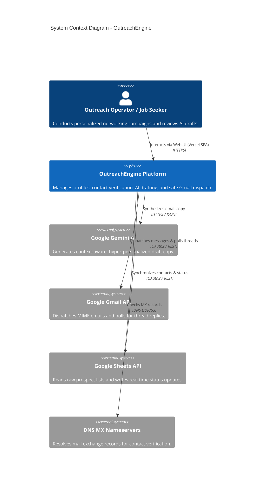
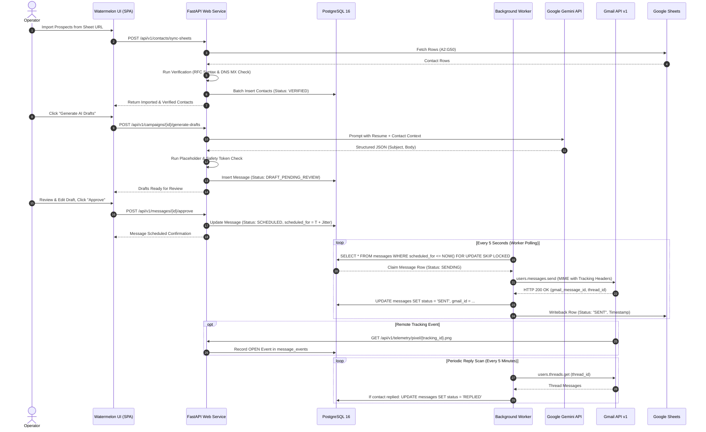
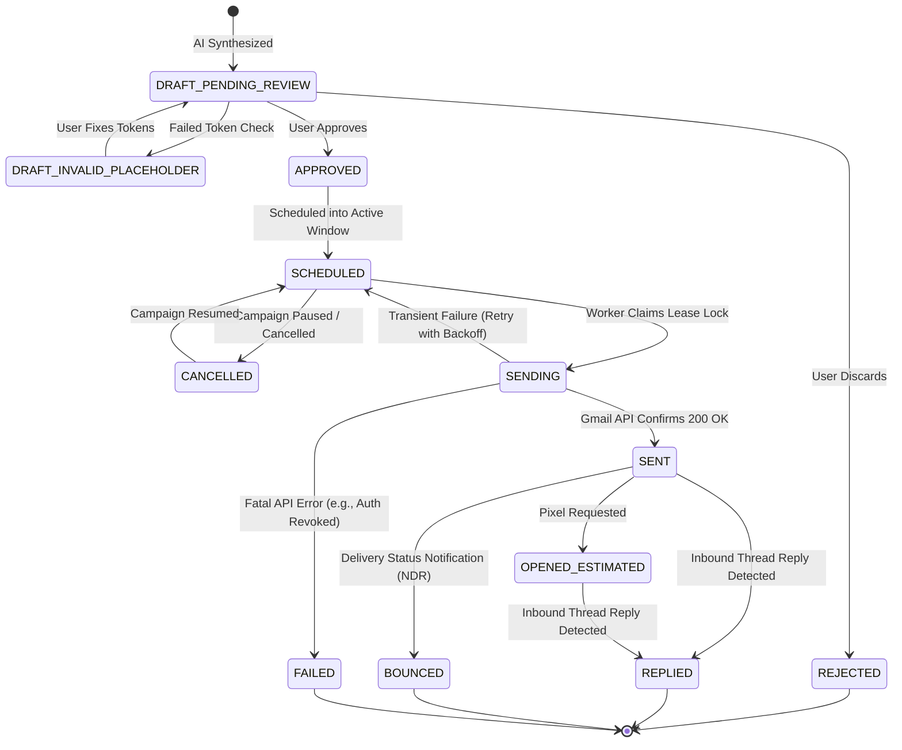
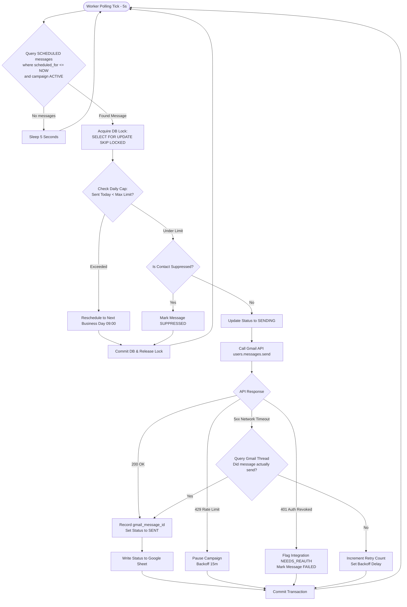

# OutreachEngine — System Architecture

**Document Version:** 1.0.0-draft  
**Status:** **`[VERIFIED]`** (Architecture Specification)  
**Author:** Principal Systems Architecture Team  
**Last Updated:** 2026-10-28  

---

## 1. System Context & High-Level Architecture

OutreachEngine is a modern, decoupled asynchronous web application. It connects human operators to external AI models and communication APIs via a resilient, transactional backend.

---

## 2. Component Topology & Service Boundaries

The platform is split into four primary tiers:

1. **Client Tier (Frontend)**:
   - Built with React 18, Vite, and modern CSS conforming to the Watermelon UI design system.
   - Deployed as a static single-page application (SPA) on Vercel with global edge CDN caching.
   - Communicates with the backend exclusively via HTTPS JSON REST APIs.
2. **API Tier (FastAPI Web Service)**:
   - Stateless asynchronous ASGI web service running on Render.
   - Handles authentication, CRUD operations for profiles and contacts, draft reviews, campaign orchestration, and tracking pixel ingestion.
   - Uses Pydantic v2 for request validation and response serialization.
3. **Data Tier (PostgreSQL Database)**:
   - Managed PostgreSQL 15+ hosted on Render.
   - Acts as the single source of truth for all relational entities, audit logs, and the **transactional dispatch queue**.
4. **Execution Tier (Background Worker)**:
   - Dedicated headless Python daemon running on Render.
   - Continuously evaluates scheduled campaigns, acquires database-backed lease locks (`SELECT ... FOR UPDATE SKIP LOCKED`), enforces daily caps, applies randomized jitter, and executes third-party API transmissions.

---

## 3. Detailed Data Flow Architecture

The end-to-end data flow from prospect ingestion to message delivery and reply detection is illustrated below:

---

## 4. Message Lifecycle State Machine

A message strictly adheres to the following deterministic finite state transitions:

---

## 5. Campaign Scheduling & Execution Engine

---

## 6. Security Boundaries & Token Isolation

1. **OAuth Credentials**:
   - Google client secrets and user refresh tokens are stored in PostgreSQL using **AES-256 (Fernet) symmetric encryption**.
   - The encryption key is injected via environment variables at runtime (`FERNET_KEY`) and is never accessible to the frontend client.
2. **Session Authentication**:
   - Web API endpoints are protected using short-lived JWT access tokens stored in `HttpOnly`, `Secure`, `SameSite=Strict` cookies.
3. **Least-Privilege Scopes**:
   - OutreachEngine restricts its Google API scopes exclusively to `gmail.send`, `gmail.readonly`, and `spreadsheets`. It never requests full inbox modification (`gmail.modify`) or Google Drive root access.

---

## 7. High Availability & Failure Recovery

- **Stateless Web Services**: The FastAPI service holds zero in-memory state; any web instance can process any API call or tracking pixel request.
- **Worker Crash Resilience**: If the background worker terminates abruptly while a message is in `SENDING` status, the lease timestamp expires after 5 minutes. The subsequent worker run will inspect the stale lease, verify delivery state with the Gmail API, and either mark the message `SENT` or re-queue it safely without duplicate sends.
